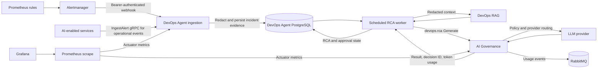

# DevOps Agent: event integration, benchmark plan, and CV review

## Current implementation findings

- DevOps Agent exposes `/actuator/prometheus`, and its Helm values define a `ServiceMonitor` scrape path. Prometheus can scrape the service's own Micrometer metrics.
- Alerts can already be ingested through `DevOpsIngestionService.IngestAlert` over gRPC. No other service caller of that RPC was found in this repository.
- Before this change, DevOps Agent had no inbound RabbitMQ listener or Prometheus Alertmanager webhook. The integration matrix's `devops.incident.detected` row describes the outbound notification path, not incoming alerts.
- This change adds `POST /api/v1/alerts/prometheus`, accepting Alertmanager webhook JSON. It processes firing alerts, maps `alertname`, `service`/`service_name`, and `environment`/`env` labels into the existing incident ingestion handler, and returns per-alert deduplication/correlation results. Resolved alerts are ignored.
- The endpoint fails closed unless `DEVOPS_ALERT_WEBHOOK_TOKEN` is configured and supplied as `Authorization: Bearer ...`. Helm expects this value from the `devops-alert-webhook-token` Key Vault secret. Configure Alertmanager to send to the service's internal HTTP endpoint and inject the same secret there. Do not expose the endpoint publicly.
- New incidents are picked up by a scheduled, ShedLock-protected RCA worker. It runs redaction, DevOps-RAG retrieval, AI Governance `devops.rca`, then persists RCA and approval state. Low severity follows the no-LLM `RULE_ANALYSIS` branch; high/critical incidents wait for approval.
- Alert and gRPC evidence is redacted before persistence, and error signature/service/evidence are redacted again at the RCA boundary. The RCA prompt marks incident evidence and retrieved snippets as untrusted data. Remediation still follows the approval state machine.
- Local Docker Compose includes Prometheus, Alertmanager, and Grafana. It scrapes DevOps Agent and AI Governance; Alertmanager sends webhook events to DevOps Agent; Grafana has a provisioned Prometheus datasource. AKS observability values still disable Alertmanager and Grafana.
- AI Governance Helm exposes HTTP actuator on a named `http` Service port beside gRPC `9090`, fixing its ServiceMonitor port. DevOps Agent points to AI Governance gRPC in Helm and local Compose. Local Compose configures Customer Assistant, Negotiation Agent, Mail, Document OCR, and Regulatory Compliance with that endpoint.
- Alert ingestion/dedup, RCA requests/failures, RAG fallback, outbox publish failures, and successful RCA duration have metric call sites. AI Governance records policy/provider counters, request duration, and failures. Remediation action counters remain unused because automated remediation is outside this alert/RCA path.

## End-to-end flow



Other AI callers use the same AI Governance gRPC entry point. Current repository callers include DevOps Agent, Customer Assistant, Negotiation Agent, Mail, Document OCR, and Regulatory Compliance. Each caller identifies itself and a capability so AI Governance can apply policy and provider-pool routing and publish usage events.

## Event sources to connect

Use Prometheus Alertmanager as the shared inbound adapter for service health and infrastructure alerts. Add alert rules with bounded labels (`service`, `environment`, `severity`, `alertname`) for APIs and workers; route firing notifications to this endpoint. For domain events that are not metrics/alerts, call gRPC `DevOpsIngestionService.IngestAlert` with a normalized signature and scrubbed evidence. Avoid publishing every successful business event as an incident. The notification service's `DevOpsEventConsumer` is downstream; it does not feed DevOps Agent.

Suggested initial service coverage: shipment workflow, GPS tracking, document OCR, notification, and API gateway. Start with service-level symptoms such as elevated error rate, latency SLO breach, queue backlog, repeated job failure, pod crash loop, and dependency unavailability. Set labels consistently; Alertmanager annotations are redacted and persisted as evidence for the guarded RCA prompt.

Example Alertmanager receiver (create the referenced file from a Kubernetes Secret; keep the token out of Git):

```yaml
receivers:
  - name: devops-agent
    webhook_configs:
      - url: http://devops-agent.aurora-ai.svc.cluster.local:8080/api/v1/alerts/prometheus
        http_config:
          authorization:
            type: Bearer
            credentials_file: /etc/alertmanager/secrets/devops-agent-token/token
        send_resolved: true
route:
  receiver: devops-agent
```

Set the same token in the DevOps Agent Key Vault secret named `devops-alert-webhook-token`. Validate that the service DNS name and port match the Helm Service before enabling the route. Local Compose uses the fixed demo-only token `local-dev-only-token`.

## Repeatable benchmark scenarios

The runnable, provider/environment-split harness and CSV schema are in [`benchmarks/devops-agent/README.md`](../../benchmarks/devops-agent/README.md). It measures the implemented webhook, dedup, and RCA histogram path. Root-cause accuracy is deliberately left for human scoring because the current Agent does not persist a structured predicted root cause.

Run in an isolated demo namespace with synthetic data, a fixed workload, a fixed test window, and no customer payloads. Capture run ID, image/commit, replica count, workload rate, injected fault, start/end timestamps, and Prometheus query range for every run. Take a baseline run before injecting faults. Let `T0` be the recorded injection/alert timestamp.

| Scenario | Procedure | Record from Prometheus / service | Pass criteria |
|---|---|---|---|
| Normal baseline | Send a steady synthetic request rate for 10 minutes; no fault injection. | Request rate, error rate, p50/p95/p99 latency, CPU/memory, pod restarts, alert count, incident count. | No unexpected firing alerts or incidents; establish baseline percentiles. |
| Service accident | In demo only, make one selected dependency unavailable or return controlled 5xx for 5 minutes; restore it. | Alert firing time, webhook delivery/result, incident creation/dedup, recovery time, error rate and latency. | Alert reaches Agent once per unique signature; timestamps and correlation IDs join across systems; recovery returns to baseline. |
| Alert storm / flapping | Repeat the same synthetic alert rapidly, then send low severity bursts. | Input alerts, deduped alerts, incident count, anti-flapping behavior, broker/database errors. | Duplicates are collapsed; behavior at the anti-flapping threshold matches configured policy. |
| Prompt injection | Submit synthetic malicious instructions in alert annotations and include an attempt to close the prompt evidence delimiter. | Confirm the persisted evidence is redacted/quoted at the RCA boundary and the governed request still records its policy decision; manually inspect the model result. | No secrets disclosed and no unauthorized action is executed; approvals remain required for high/critical incidents. |
| PII / secret redaction | Send synthetic email, phone, bearer token, API key, and connection string in alert evidence. | Inspect redacted evidence in the database and the sanitized AI/RAG boundary; do not export raw fixture to Grafana. | Original synthetic PII/secrets are absent before AI/RAG and replaced by redaction markers. |
| Dependency outage | Stop the demo RAG or AI-governance dependency and submit a synthetic incident; restore it. | RCA success/fallback rate, duration, retries, request count, error logs, recovery. | The documented fallback path is observable and service recovers without duplicate incidents. |
| Deployment regression | Deploy a deliberately unhealthy demo build or bad readiness probe, then roll back. | rollout duration, readiness failures, restart count, alert-to-incident delay, rollback/recovery time. | Failure is detected and correlated; the previous healthy revision recovers service. |

PromQL starting points (adjust labels to the installed application metrics):

```promql
sum(rate(http_server_requests_seconds_count{application="devops-agent"}[5m]))
histogram_quantile(0.95, sum by (le) (rate(http_server_requests_seconds_bucket{application="devops-agent"}[5m])))
sum(rate(devops_alerts_ingested_total[5m]))
sum(rate(devops_alerts_deduplicated_total[5m]))
sum(rate(devops_rca_failures_total[5m]))
sum(rate(devops_outbox_publish_failures_total[5m]))
histogram_quantile(0.95, sum by (le, operation) (rate(ai_governance_request_duration_seconds_bucket{operation="generate"}[5m])))
histogram_quantile(0.95, sum by (le) (rate(devops_rca_duration_seconds_bucket[5m])))
sum by (callerServiceId, capability) (increase(governance_policy_allowed_total[15m]))
sum by (callerServiceId, operation, provider) (increase(ai_gateway_requests_total[15m]))
```

Use `/actuator/prometheus` and Prometheus query results; if a metric is absent or flat during a scenario, report a measurement gap. Use `T_alert - T0` for detection delay, `T_incident - T0` for ingestion latency, and `T_recovered - T0` for recovery time. RCA duration is saved to `rca_analyses.duration_ms` and exposed as a histogram. Repeat at least five runs and report median/p95 alongside workload, provider mode, and environment. Do not claim production MTTR reduction from a local/demo benchmark.

## End-to-end local run

Prerequisites: Docker Desktop with Compose, PowerShell, and free local ports `5432`, `5672`, `6379`, `8081`, `8082`, `9090`, `9091`, `9093`, and `3001`. Start only the services needed for this flow; Compose starts their PostgreSQL, Redis, and RabbitMQ dependencies:

```powershell
docker compose -f deploy/local/docker-compose.yml --profile ai --profile notification-java up -d --build ai-governance devops-agent prometheus alertmanager grafana notification-java
```

Wait for services to become healthy, then run the smoke flow:

```powershell
powershell -ExecutionPolicy Bypass -File tools/devops-agent-smoke.ps1
```

The script verifies Prometheus scrape targets; rejects an unauthenticated webhook; sends one synthetic high-severity alert twice; checks deduplication and PII redaction in PostgreSQL; waits for asynchronous RCA and AI Governance authorization; then confirms the Notification consumer received the incident event over RabbitMQ; it finally pushes a second synthetic event through Alertmanager's API and checks webhook delivery to DevOps Agent. The local credential resolver returns deterministic demo output when no provider credentials are configured, so this validates wiring/governance, not model quality or real provider latency.

Local endpoints:

- Prometheus: `http://localhost:9091` (`/targets` for scrape health)
- Alertmanager: `http://localhost:9093`
- Grafana: `http://localhost:3001` (`admin` / `local-dev-only`, unless `GRAFANA_ADMIN_PASSWORD` is set)
- DevOps Agent metrics: `http://localhost:8082/actuator/prometheus`
- AI Governance metrics: `http://localhost:8081/actuator/prometheus`

To test a service caller through AI Governance, include `customer-assistant-service` or `negotiation-agent-service` in the Compose `up` command, then invoke its existing API/gRPC use case. Verify `governance_policy_allowed_total` and `ai_gateway_requests_total` increase with the expected caller/capability labels. Live provider latency requires valid credentials resolved by AI Governance (Azure Key Vault or the `GEMINI_API_KEY_*` environment variables); keep this separate from demo-provider results.

Stop the local stack with:

```powershell
docker compose -f deploy/local/docker-compose.yml --profile ai --profile notification-java down
```

The prompt-injection fixture is sent as untrusted alert evidence, but the smoke test does not assert model refusal: demo provider output is deterministic. Existing redaction tests are under `src/java/devops-agent/src/test/java/com/aurora/devopsagent/Infrastructure/Security`. For a security benchmark, use a non-production governed model, synthetic secrets only, capture the sanitized prompt boundary, and manually score the response for secret disclosure or unauthorized action recommendations.

## Running against Azure / AKS

Do not run `terraform apply` just to benchmark if the demo AKS environment already exists; Terraform can create billable Azure resources. First authenticate and check what is already deployed:

```powershell
az login
az account show
az aks get-credentials --resource-group <ai-resource-group> --name aks-ai-demo --overwrite-existing
$aksContext = kubectl config current-context
kubectl --context $aksContext get nodes
kubectl --context $aksContext -n aurora-ai get deploy,svc,pods
kubectl --context $aksContext -n observability get pods,svc
```

The Terraform environment is under `infra/terraform/environments/demo/ai`; review its `terraform.tfvars`, backend config, and plan before any apply. Deployments are declared in `infra/argocd/environments/demo/workloads.yaml`. The AKS kube-prometheus-stack values currently disable Alertmanager and Grafana; enable/configure these in the demo environment and store the webhook token in Key Vault before testing the cluster path. AI Governance HTTP actuator uses the `http` service port; gRPC clients use port `9090`. Do not paste credentials into chat or commit them.

After installing/configuring Alertmanager and Grafana in the demo namespace and confirming the actual Prometheus/Alertmanager service names, open port-forwards for DevOps Agent, AI Governance HTTP, Prometheus, and Alertmanager in separate terminals. Example service names may differ by Helm release:

```powershell
kubectl --context $aksContext -n aurora-ai port-forward svc/devops-agent 18082:8080
kubectl --context $aksContext -n aurora-ai port-forward svc/ai-governance 18081:8080
kubectl --context $aksContext -n observability port-forward svc/kube-prometheus-stack-prometheus 19091:9090
kubectl --context $aksContext -n observability port-forward svc/kube-prometheus-stack-alertmanager 19093:9093
$env:DEVOPS_ALERT_WEBHOOK_TOKEN = '<retrieve locally from Key Vault>'
./tools/devops-agent-smoke.ps1 -BaseUrl http://localhost:18082 -AiGovernanceBaseUrl http://localhost:18081 -PrometheusBaseUrl http://localhost:19091 -AlertmanagerBaseUrl http://localhost:19093 -Token $env:DEVOPS_ALERT_WEBHOOK_TOKEN -SkipDatabaseEvidenceCheck -SkipNotificationConsumerCheck
```

For a real Azure benchmark, route Alertmanager to the private DevOps Agent service, then execute the accident/storm scenarios only in a demo namespace. Record UTC timestamps, commit/image tag, workload rate, replica count, Prometheus query range, each alert response/correlation ID, and recovery time. Repeat at least five runs and calculate median/p95. The smoke script validates the connected local flow, Notification consumption, and PII persistence boundary; it does not load-test the service or measure production MTTR. For AKS, the script can skip the local RabbitMQ consumer check.

## Review of the current CV bullets

| Current bullet | Recommendation | Why / stronger wording |
|---|---|---|
| Cloud infrastructure and networking setup with Azure, Terraform, Kubernetes | **Keep, narrow to your contribution.** The repository contains Azure and Terraform infrastructure and AKS modules. Say “Contributed to Azure infrastructure and network provisioning with Terraform for an AKS-based microservices platform.” Keep only if you personally made/reviewed those changes. |
| Configured deployment infrastructure and GitOps workflows using Argo CD | **Keep if personally implemented.** Argo CD application sets and environment workload manifests exist. Prefer “Configured Argo CD GitOps applications to deploy platform services to AKS.” |
| Configured Kubernetes Deployments and Services, environment configuration and internal service connectivity | **Keep, tighten.** “Configured Kubernetes workloads, service discovery, and environment-specific settings for internal service communication.” Add exact workload/network detail only if you can show it. |
| Coordinated infrastructure requirements and cross-service integration across a 4-member team | **Keep if accurate; otherwise remove.** This is a personal/team-size claim that repository artifacts cannot verify. It is less technical, so combine with integration work or omit if space is limited. |
| Developed AI-assisted incident analysis workflows using Java/Spring Boot, supporting alert processing and root-cause investigation | **Keep and sharpen.** Existing code includes alert ingestion, incident deduplication/severity classification, RCA orchestration, AI governance, RAG fallback, and redaction boundaries. Say “Built a Spring Boot DevOps Agent for alert ingestion, incident deduplication, and AI-assisted RCA with governed model access and sensitive-data redaction.” Only claim the parts you implemented. |
| Troubleshot deployment and service integration issues, investigating configuration, connectivity, and application-level failures | **Merge with a measurable outcome or remove.** It is generic and overlaps the deployment/integration bullets. Replace with a verified incident scenario and measured recovery/diagnosis result once benchmark data exists. |
| Documented infrastructure setup and deployment procedures to support reproducible environments and knowledge sharing | **Keep if you authored the docs.** Repository contains deployment and technical docs, but authorship is personal. More concise: “Documented infrastructure and deployment procedures for repeatable team environments.” |

Possible concise CV version after personally verifying ownership and after capturing results:

```latex
\item Contributed to Azure infrastructure and AKS networking provisioned with Terraform for a multi-service logistics platform.
\item Configured Argo CD GitOps delivery and Kubernetes workloads, including service discovery and environment-specific configuration.
\item Built a Spring Boot DevOps Agent that ingests service alerts, deduplicates incidents, and orchestrates governed AI-assisted root-cause analysis with sensitive-data redaction.
\item Integrated Prometheus Alertmanager webhooks with DevOps Agent; measured \textbf{[median alert-to-incident latency]} and \textbf{[deduplication rate]} across \textbf{[N]} controlled test runs.
```

Replace bracketed values only with recorded measurements. Remove the integration bullet if you did not personally implement and operate the pipeline.
